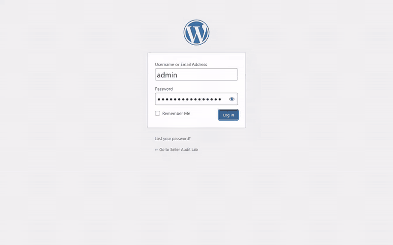

# WordPress and Elementor lab



Landing page built in the real Elementor editor on local WordPress, then audited with a 15 check SEO script.

[](https://github.com/Exalt24/wordpress-elementor-lab/actions/workflows/ci.yml)

The audit found three things missing. A small must-use plugin fixes them, and a re-run passes. Everything runs locally in Docker. The page is a demo for an Amazon seller-audit service concept and says so in its footer.

## What is in it

| Part | What it does |
|---|---|
| `docker-compose.yml`, `scripts/setup.sh` | WordPress 6 and MariaDB in Docker, WP-CLI install, the free Elementor plugin (4.3.3 when I built it; `setup.sh` installs whatever version is current) and the Hello Elementor theme |
| `scripts/build_page.cjs` | Opens the Elementor editor in a headless browser and builds the page with the editor's own command API (`$e.run('document/elements/create')`), then saves with the editor's publish command. Five sections: hero, three audit cards, how it works, request, footer note. Free widgets only |
| `scripts/seo_audit.py` | A 15-check technical SEO audit: status and redirects, title and meta description length, one h1, heading order, image alt text, canonical, language, viewport, Open Graph, valid JSON-LD, broken links, response time, page weight. Standard library only |
| `wp/mu-plugins/seo-basics.php` | The fix for what the audit found: meta description from the page excerpt, Open Graph tags and a Service JSON-LD block |
| `tests/test_seo_audit.py` | Nine offline tests: a clean page passes everything, and eight pages with exactly one defect each fail exactly that check |
| `scripts/keyword_research.py` | Keyword and topic research from Google, Bing and DuckDuckGo autocomplete (no key): expands seeds with question and modifier words, scores by source agreement and position, groups the keywords into pages and writes a content map with internal links and title and meta drafts |
| `scripts/ai_visibility.py` | Asks a model a list of questions several times and counts how often named organisations appear in the answers, with a 95 percent Wilson interval. Runs on a local Ollama model or any OpenAI compatible endpoint |
| `tests/test_keyword_research.py`, `tests/test_ai_visibility.py`, `tests/mutation_check.py` | 37 and 19 offline checks, and a script that breaks 24 guards one at a time and needs a test to go red each time. CI runs all of them |
| `docs/launched-site.md` | A public six page WordPress.com site on the free plan, built in the block editor from the keyword research content map: https://emergencycaretrainingguidesample.wordpress.com/ . Audited with the same 15 checks, with the screenshots, the audit outputs and an edit and revert in the editor saved beside it, then a design pass against three medical education sites with before and after screenshots, and `scripts/contrast_check.cjs` for computed contrast, tap size and overflow |

## What the audit found

The first run on the freshly built page scored **12 of 15**. It was missing the meta description, the Open Graph tags and any structured data. That is what this page looked like with no SEO plugin. After the mu-plugin and a page excerpt it scores **15 of 15**. Both outputs are kept in `docs/seo_before.txt` and `docs/seo_after.txt`. The setup script mounts the mu-plugin and sets the excerpt from the start, so a fresh run gives 15 of 15; to see the 12 of 15 again, remove the `wp/mu-plugins` mount from `docker-compose.yml` and the excerpt step from `scripts/setup.sh` first.

The screenshot below is the page at 390 px wide, with the cards stacked.


## What the keyword and AI scripts found

Three seeds about emergency medicine training gave 166 distinct keywords from 108 autocomplete responses, grouped into 14 pages around a pillar page, in [docs/keyword-research-sample.md](docs/keyword-research-sample.md).

The AI check asked a local qwen3.5:9b model 12 of those questions three times each (36 answers, 0 errors) and counted six public names. The American Heart Association appeared in 24 of 36 answers (67 percent, interval 50 to 80), ACEP and Medscape in 2 each, and EM:RAP, Hippo Education and UpToDate in none. It named the American Heart Association in all three answers to 8 of the 9 ACLS questions and never for the two CME questions, where Medscape appeared once in each. The table per question is in [docs/ai-visibility-sample.md](docs/ai-visibility-sample.md).

## What the launched site shows

The six page site is live on a free WordPress.com subdomain and was built from the keyword research content map: a front page, three topic pages, a questions page and an about page, with a menu and a footer. Its pages score 12 to 13 of 15 on the audit. The misses are no JSON-LD, which the free plan has no plugin for, one 403 on WordPress.com's own login link, and two titles over the length limit because the site title is added to each page title. The causes and the free plan limits are written up in [docs/launched-site.md](docs/launched-site.md), with screenshots at 1280 and 390 pixels wide and a page edited and reverted in the block editor. A later design pass compared the pages with Medscape Education, the American Heart Association course list and ACEP, then changed type, spacing, colour, the hero button, the phone menu and the footer in the block editor. The contrast check finds no text under WCAG AA on any page at either width. The before and after pictures and the free plan limits it hit are in the same file, under Design pass.

## Run it

Needs Docker, Python 3, `bash` and `curl`, and Node with Playwright installed globally (`npm install -g playwright`). The build and screenshot scripts load Playwright from the global npm folder of a Windows user (under `%APPDATA%`). On another system, change the `require` line at the top of each.

```
bash scripts/setup.sh
node scripts/build_page.cjs ./shots $(cat .page_id)
python scripts/seo_audit.py http://localhost:8087/seller-audit/
python tests/test_seo_audit.py
```

The keyword and AI answer scripts need only Python 3, and the AI one needs a local Ollama model or an OpenAI compatible endpoint with a key. Details and limits are in [docs/seo-keyword-and-ai-visibility.md](docs/seo-keyword-and-ai-visibility.md).

```
python scripts/keyword_research.py "emergency medicine cme" "acls recertification online" "ultrasound course for emergency physicians" --replay tests/fixtures/suggestions.json
python scripts/ai_visibility.py --questions tests/fixtures/questions.txt --entities "ACEP,Medscape" --model qwen3.5:9b
python tests/test_keyword_research.py && python tests/test_ai_visibility.py && python tests/mutation_check.py
```

The local login is `admin` / `admin-local-only` at `http://localhost:8087/wp-admin`. It is a local site that `scripts/setup.sh` creates.

## Scope and next steps

- It runs as a local site in Docker. The page is a demo for a service concept.
- The page was assembled through the editor's command API in a headless browser. Elementor itself produced and saved the page data. The editor opens and edits the result normally.
- Only free Elementor widgets are used, so the request section is a mailto line. Next step: Pro widgets such as forms and loop grids.
- The keyword suggestions are not search volumes, because no keyless source gives volumes. The AI answer check asks a model: the sample run used a local model, which does not browse and is not ChatGPT or Perplexity. Google AI Overviews have no API and are not checked.
- The audit checks one page's technical basics, with alt text and heading order as its accessibility checks. Next steps: rankings and speed under load.
