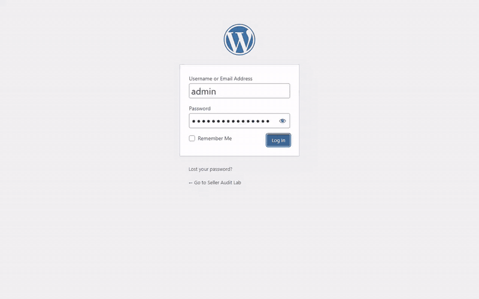
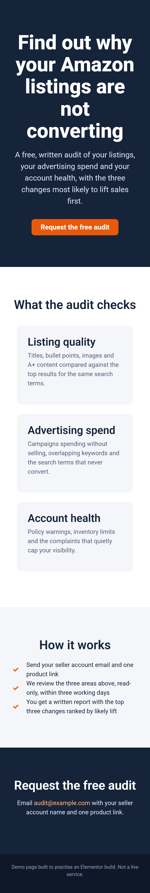

# WordPress and Elementor lab



Landing page built in the real Elementor editor on local WordPress, audited with a 15 check SEO script, and the same audit run on a stock OpenCart store that an extension then fixes.

[](https://github.com/Exalt24/wordpress-elementor-lab/actions/workflows/ci.yml)

The audit found three things missing. A small must-use plugin fixes them, and a re-run passes. Everything runs locally in Docker. The page is a demo for an Amazon seller-audit service concept and says so in its footer.

The same audit then ran on a stock OpenCart 4 store (PHP) with a small sample catalogue. A fresh OpenCart scores 8, 10 and 10 of 15 on its home, category and product pages, and an extension plus a few settings take all three to 15 of 15. See [What the OpenCart store shows](#what-the-opencart-store-shows).

A WooCommerce shop in [`bullion-shop/`](bullion-shop/docs/bullion-shop.md) prices twelve invented gold and silver products live from a stand-in metals feed. One saved price reading instead of a feed call per product cut the shop page's server response from 1969 ms to 233 ms, and trimming the render blocking files took the mobile Lighthouse score from 91 to 98. It also has a spot price shortcode, Product, Organization and FAQ markup, a Merchant Center feed and hardening.

## What is in it

| Part | What it does |
|---|---|
| `docker-compose.yml`, `scripts/setup.sh` | WordPress 6 and MariaDB in Docker, WP-CLI install, the free Elementor plugin (4.3.3 when I built it; `setup.sh` installs whatever version is current) and the Hello Elementor theme |
| `scripts/build_page.cjs` | Opens the Elementor editor in a headless browser and builds the page with the editor's own command API (`$e.run('document/elements/create')`), then saves with the editor's publish command. Five sections: hero, three audit cards, how it works, request, footer note. Free widgets only |
| `scripts/seo_audit.py` | A 15-check technical SEO audit: status and redirects, title and meta description length, one h1, heading order, image alt text, canonical, language, viewport, Open Graph, valid JSON-LD, broken links, response time, page weight. Standard library only |
| `wp/mu-plugins/seo-basics.php` | The fix for what the audit found: meta description from the page excerpt, Open Graph tags and a Service JSON-LD block |
| `tests/test_seo_audit.py` | Ten offline tests: a clean page passes everything, eight pages with exactly one defect each fail exactly that check, and a relative link is checked against the page's `<base href>` (the OpenCart crawl showed the audit was getting that wrong) |
| `scripts/keyword_research.py` | Keyword and topic research from Google, Bing and DuckDuckGo autocomplete (no key): expands seeds with question and modifier words, scores by source agreement and position, groups the keywords into pages and writes a content map with internal links and title and meta drafts |
| `scripts/ai_visibility.py` | Asks a model a list of questions several times and counts how often named organisations appear in the answers, with a 95 percent Wilson interval. Runs on a local Ollama model or any OpenAI compatible endpoint |
| `tests/test_keyword_research.py`, `tests/test_ai_visibility.py`, `tests/mutation_check.py` | 37 and 19 offline checks, and a script that breaks 39 guards one at a time (Python and PHP) and needs a test to go red each time. CI runs all of them |
| `opencart/` | A stock OpenCart 4.1 store in Docker (PHP 8.2, MariaDB) with a six product sample catalogue, and the fix as an OpenCart extension, `opencart/extension/seolab/`, wired in with six events so no core file is edited: canonical links, meta descriptions, Open Graph, JSON-LD, a home page `h1`, heading order, a title length rule and an XML sitemap. `opencart/scripts/run_lab.sh` builds the store, audits it, applies the fix, audits again and writes `docs/opencart_before.txt`, `docs/opencart_after.txt` and `docs/opencart_checks.txt` |
| `opencart/tests/test_markup.php` | 29 offline PHP checks on the markup builders, each on a good input and a hostile or empty one (a product name that tries to close the JSON-LD script tag, a sitemap address with an ampersand, an out of stock product). CI runs them on Linux with the runner's PHP |
| `bullion-shop/` | A local WooCommerce shop in Docker with twelve invented gold and silver products priced live from a stand-in metals feed, with a cached price reading, Product and Offer markup, a Merchant Center feed and hardening. Every number: [bullion-shop/docs/bullion-shop.md](bullion-shop/docs/bullion-shop.md) |
| `moodle-lab/` | A local Moodle 5.0 LMS in Docker with a course, a teacher and a student made through its web service API, and five Tier 1 support tickets reproduced, diagnosed, fixed and checked as the student: [moodle-lab/docs/moodle-support-cases.md](moodle-lab/docs/moodle-support-cases.md) |
| `genesis-lab/` | DEV and PROD WordPress, a safe sync, a case study plugin with a jQuery AJAX filter, two child themes, a PSD page: [genesis-lab/README.md](genesis-lab/README.md) |
| `docs/launched-site.md` | A public six page WordPress.com site on the free plan, built in the block editor from the keyword research content map: https://emergencycaretrainingguidesample.wordpress.com/ . Audited with the same 15 checks, then a design pass against three medical education sites with before and after screenshots, and `scripts/contrast_check.cjs` for computed contrast, tap size and overflow |
| `docs/qa-defect-report.md` | A QA defect report from testing the launched site and a second sample site at 1280 and 390 pixels wide: 9 reproduced defects with steps, expected and actual results, cropped screenshots and a suggested fix each, then what was found clean |

## What the audit found

The first run on the freshly built page scored **12 of 15**. It was missing the meta description, the Open Graph tags and any structured data. That is what this page looked like with no SEO plugin. After the mu-plugin and a page excerpt it scores **15 of 15**. Both outputs are kept in `docs/seo_before.txt` and `docs/seo_after.txt`. The setup script mounts the mu-plugin and sets the excerpt from the start, so a fresh run gives 15 of 15; to see the 12 of 15 again, remove the `wp/mu-plugins` mount from `docker-compose.yml` and the excerpt step from `scripts/setup.sh` first.

The screenshot below is the page at 390 px wide, with the cards stacked.



## What the OpenCart store shows

OpenCart is a PHP storefront, so the fixes live in PHP and Twig, not in a plugin screen. `bash opencart/scripts/run_lab.sh` builds the stock store, audits three pages, applies the fix and audits them again. Both outputs are in `docs/opencart_before.txt` and `docs/opencart_after.txt`.

| Page | Fresh OpenCart | After the fix |
|---|---|---|
| Home | 8 of 15: title is "Your Store", no meta description, no `h1`, no canonical, no Open Graph, no JSON-LD, and a slideshow link to a demo product that returns a 404 | 15 of 15 |
| Category | 10 of 15: a 9 character title, no meta description, heading levels jump from `h1` to `h4`, no Open Graph, no JSON-LD | 15 of 15 |
| Product | 10 of 15: a 17 character title, no meta description, headings jump from `h2` to `h5`, no Open Graph, no JSON-LD | 15 of 15 |

What changed, and where (settings and data, crawl and index, structured data, headings and titles), and the bug the crawl found in the audit's own link check: [docs/opencart-fix.md](docs/opencart-fix.md).

## What the bullion shop shows

A shop that prices gold and silver from the spot price needs a current price on every page view, and the price must never be wrong. `bullion-shop/` builds that on WooCommerce against a stand-in feed with invented prices and measures three states of the same shop.

| Shop page, same laptop, same feed | Before | Saved price | Saved price, lean assets |
|---|---|---|---|
| Feed calls in 6 page loads | 72 | 0 | 0 |
| Time to first byte (median of 6) | 1.92 s | 0.07 s | 0.06 s |
| Lighthouse mobile server response (median of 3) | 1969 ms | 233 ms | 245 ms |
| Lighthouse mobile performance score (3 runs) | 89, 88, 89 | 91, 91, 91 | 99, 98, 98 |
| Largest Contentful Paint (median of 3) | 3.2 s | 3.2 s | 2.3 s |
| First Contentful Paint and Speed Index | 2.3 s and 4.0 s | 2.3 s and 2.3 s | 1.2 s and 1.2 s |
| Outside hardening probes passed | 1 of 13 | not run | 13 of 13 |

The saved price keeps one reading for 10 seconds, lets one request at a time refresh it, throws away a reading that jumped more than 15 percent, shows the last good price marked stale for up to 40 seconds and then no price at all. That removes the server wait but not the paint time, which the theme's files set. The lean assets do that: Google Fonts, block and brand styles the page does not use, the jQuery Migrate shim and a 15 KB icon font stylesheet that is 97 percent unused are dropped or loaded without blocking, and jQuery moves to the footer. These are Lighthouse's simulated mobile figures on the local page; a check afterwards found no console errors on three pages and a working cart.

* **Bad days, markup and hardening**: 14 of 14 live checks on a dead or wild feed, an Offer that no longer claims a price is valid until the end of the year, and a WordPress layer hardening list. The detail is in [bullion-shop/docs/bullion-shop.md](bullion-shop/docs/bullion-shop.md).
* **Tests**: 85 PHP checks on the rules, 32 Python checks and all 79 guards in `tests/mutation_check.py`.

Run it with `bash bullion-shop/scripts/run_lab.sh` (Docker, Python 3, bash, curl; about 20 minutes); the shop opens at `http://localhost:8089/` and the admin password is made on your machine in `bullion-shop/build/admin_password.txt`. Limits: [bullion-shop/docs/bullion-shop.md](bullion-shop/docs/bullion-shop.md#limits).

## What the Moodle lab shows

`moodle-lab/` runs Moodle 5.0 locally, makes the people and the course through its web service API, breaks one thing per ticket and fixes it the way an admin would, then logs in as the student to check.

| Ticket | What the student saw | What the admin found | Fix |
|---|---|---|---|
| Cannot see the course | My courses empty | Student not in the enrolled users | Enrol as Student |
| Cannot see the course | Enrolled, My courses empty | Course visibility set to Hide | Show the course |
| Locked out | The correct password refused | Lockout flag set; the log shows 3 wrong passwords, then refusals with the lockout code | Unlock the account |
| Assignment unavailable | Sent to the course page, "Available from" a year away | Restrict access date typed with the wrong year | Move the date to yesterday |
| Assignment unavailable | Sent to the course page, "currently hidden" | Activity visibility set to Hide | Show the activity |

17 offline checks on the diagnosis code, 17 live checks against the container and 16 deliberate breaks that each turn a test red. Run it with `bash moodle-lab/scripts/setup.sh` (Docker, Python 3, bash, curl; about five minutes), then `python moodle-lab/scripts/cases.py --shots`. What was hard, the screenshots and the limits (a local Moodle on invented data, no Blackboard, Canvas or D2L, no SSO or LTI) are in [moodle-lab/docs/moodle-support-cases.md](moodle-lab/docs/moodle-support-cases.md).

## What the keyword and AI scripts found

Three seeds about emergency medicine training gave 166 distinct keywords grouped into 14 pages around a pillar page ([docs/keyword-research-sample.md](docs/keyword-research-sample.md)). A local qwen3.5:9b model, asked 12 of those questions three times each, named the American Heart Association in 24 of 36 answers (67 percent, interval 50 to 80) and ACEP and Medscape in 2 each; the table per question is in [docs/ai-visibility-sample.md](docs/ai-visibility-sample.md).

## What the launched site shows

A six page site on a free WordPress.com subdomain, built from the keyword research content map, scores 12 to 13 of 15 on the audit, with a design pass and a QA defect report. Details, screenshots and the free plan limits: [docs/launched-site.md](docs/launched-site.md), [docs/launched-site-summary.md](docs/launched-site-summary.md) and [docs/qa-defect-report.md](docs/qa-defect-report.md).

## Run it

The OpenCart store needs only Docker, Python 3, `bash` and `curl`: `bash opencart/scripts/run_lab.sh` (about two minutes), then browse `http://localhost:8088/` and the admin at `/admin/` (`admin` / `admin-local-only`). `bash opencart/scripts/setup.sh` returns it to the stock store and `bash opencart/scripts/fix.sh` applies the fix again. The WordPress part below needs the extras it lists.

Needs Docker, Python 3, `bash` and `curl`, and Node with Playwright installed globally (`npm install -g playwright`). The build and screenshot scripts load Playwright from a Windows user's global npm folder; on another system change the `require` line at the top of each.

```
bash scripts/setup.sh
node scripts/build_page.cjs ./shots $(cat .page_id)
python scripts/seo_audit.py http://localhost:8087/seller-audit/
python tests/test_seo_audit.py
```

The keyword and AI answer scripts need only Python 3 (the AI one also a local Ollama model or an OpenAI compatible endpoint). Details: [docs/seo-keyword-and-ai-visibility.md](docs/seo-keyword-and-ai-visibility.md).

```
python scripts/keyword_research.py "emergency medicine cme" "acls recertification online" "ultrasound course for emergency physicians" --replay tests/fixtures/suggestions.json
python scripts/ai_visibility.py --questions tests/fixtures/questions.txt --entities "ACEP,Medscape" --model qwen3.5:9b
python tests/test_keyword_research.py && python tests/test_ai_visibility.py && python tests/mutation_check.py
```

The local login is `admin` / `admin-local-only` at `http://localhost:8087/wp-admin`, a site that `scripts/setup.sh` creates.

## Scope and next steps

- It runs as a local site in Docker. The page is a demo for a service concept, the OpenCart shop is a sample outdoor store with six products, and the bullion shop uses sample products and a stand-in price feed.
- The page was assembled through the editor's command API in a headless browser, and Elementor itself produced and saved the page data. Only free widgets are used, so the request section is a mailto line. Next: Pro widgets such as forms.
- The keyword suggestions are not search volumes, because no keyless source gives volumes. The AI answer check asks a local model, which does not browse and is not ChatGPT or Perplexity; Google AI Overviews have no API and are not checked.
- The audit checks one page's technical basics, with alt text and heading order as its accessibility checks. Next steps: rankings and speed under load.
