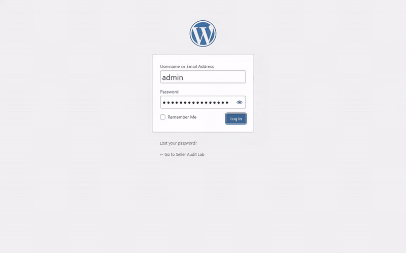

# WordPress and Elementor lab



A landing page built **inside the real Elementor editor** on a local WordPress, then audited the way a website specialist would: a technical SEO check that found three things missing, a small must-use plugin that fixes them, and a re-run that passes. Everything runs locally in Docker. The page is a demo for an imaginary Amazon seller-audit service and says so in its footer, so there is no client, no customer and no real business behind it.

## What is in it

| Part | What it does |
|---|---|
| `docker-compose.yml`, `scripts/setup.sh` | WordPress 6 and MariaDB in Docker, WP-CLI install, the free Elementor plugin (4.3.3 when built) and the Hello Elementor theme |
| `scripts/build_page.cjs` | Opens the Elementor editor in a headless browser and builds the page with the editor's own command API (`$e.run('document/elements/create')`), then saves with the editor's publish command. Five sections: hero, three audit cards, how it works, request, footer note. Free widgets only |
| `scripts/seo_audit.py` | A 15-check technical SEO audit: status and redirects, title and meta description length, one h1, heading order, image alt text, canonical, language, viewport, Open Graph, valid JSON-LD, broken links, response time, page weight. Standard library only |
| `wp/mu-plugins/seo-basics.php` | The fix for what the audit found: meta description from the page excerpt, Open Graph tags and a Service JSON-LD block |
| `tests/test_seo_audit.py` | Nine offline tests: a clean page passes everything, and eight pages with exactly one defect each fail exactly that check |

## What the audit found

The first run on the freshly built page scored **12 of 15**. It was missing the meta description, the Open Graph tags and any structured data, which is the usual state of a page built in a visual builder with no SEO plugin. After the mu-plugin and a page excerpt it scores **15 of 15**. Both outputs are kept in `docs/seo_before.txt` and `docs/seo_after.txt`.

The page also fits a phone: no horizontal overflow at 390 px, cards stacked.


## Run it

Needs Docker, Node and Python 3.

```
bash scripts/setup.sh
node scripts/build_page.cjs ./shots $(cat .page_id)
python scripts/seo_audit.py http://localhost:8087/seller-audit/
python tests/test_seo_audit.py
```

The lab login is `admin` / `admin-local-only` at `http://localhost:8087/wp-admin`. It is a throwaway local site with no real data.

## Limits, stated plainly

- It is a local lab, not a deployed site, and the page is a demo with no real business behind it.
- The page was assembled through the editor's command API in a headless browser rather than by dragging widgets by hand. Elementor itself produced and saved the page data, and the editor opens and edits the result normally, but this is not a record of hand-built design work.
- Only free Elementor widgets are used. The Pro widgets (forms, loop grids and so on) are not involved, so the request section is a mailto line and not a form.
- The audit checks one page's technical basics. It does not measure rankings, speed under load or accessibility beyond alt text and heading order.
