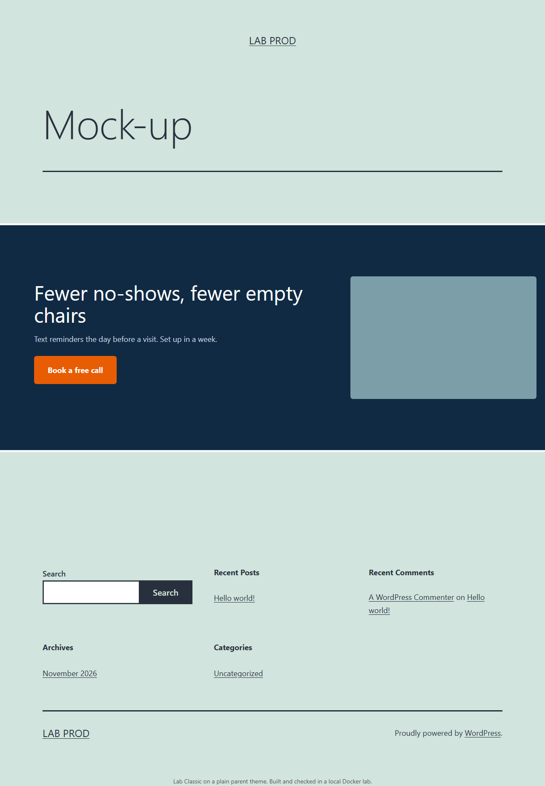
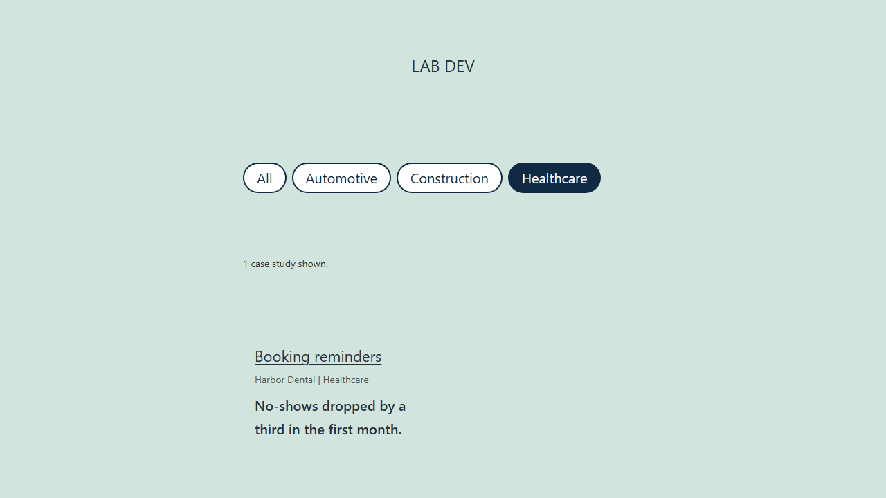

# genesis-lab

A WordPress build with a DEV site and a PROD site on one MariaDB, two child themes over one set of functionality, Advanced Custom Fields kept in code, a sync script that is the only road into PROD, and a page converted from a layered PSD mock-up.



*A screenshot of the real PROD page at 1280 pixels wide. The phone view stacks the picture under the text: [phone screenshot](docs/mockup-phone.png).*

The case study post type, its industry taxonomy, the ACF fields and the content filters live in one must-use plugin (`mu-plugins/lab-core.php`), so a theme change cannot lose them. Each child theme only places things with its parent's own hooks: `lab-classic` on Twenty Twenty-One uses `loop_start` and `wp_footer`, and `lab-child` on the Genesis Framework uses `genesis_before_loop` and `genesis_footer_creds_text`.

## What was measured

- `python scripts/check_lab.py` ran against both live sites with no failures: DEV and PROD both serve the three case study cards, the archive, the single page with its result first and the theme's footer credit. PROD carries no DEV address, keeps its own site name, runs the same theme as DEV, and a case study with script tags in its title and fields prints escaped.
- `python scripts/mutation_check.py` breaks a copy of the lab 33 ways and the file checks caught all 33. Thirteen are in the theme and plugin (the REST flag, the taxonomy, ACF JSON saving, an unescaped field, the content filter, both ACF field names, the Template line of each theme, each theme's hook, case study logic put back into a theme) and twenty are in the industry filter below. Its first run found two checks that passed on a broken lab; both were tightened.
- A live version of the escaping break (the plugin printing a result without `esc_html`) failed two checks on the running site, then the file was restored.
- `node scripts/check_mockup.cjs` loads the converted page at 1280 and 390 pixels: the picture sits beside the text on a wide screen and under it on a phone, nothing spills past the screen width, and the band, button and picture colours are the ones read from the PSD.

## Industry filter

Choosing an industry on the front page swaps the case study cards with no page reload. A jQuery script (`mu-plugins/lab-core-assets/cases-filter.js`, with WordPress's bundled jQuery as its dependency) posts to a WordPress admin-ajax handler in `lab-core.php`, which checks a nonce, sanitizes the industry, reads the cards with `WP_Query` and a `tax_query` and returns escaped HTML as JSON. The buttons are real `<button>` elements with `aria-pressed`, and with JavaScript off the full grid is already on the page. The cards, the script and the handler are in the shared plugin, so the filter runs on the DEV site as it stands, on `lab-classic`; `lab-child` calls the same function from its Genesis hook and passes the same file checks, but has not been run live.



*The DEV front page at 1280 pixels after choosing Healthcare. The phone view at 390 pixels: [phone screenshot](docs/filter-phone.png).*

`python scripts/check_filter.py` passed 27 file checks and 42 live checks in a real browser on DEV (the run adds two published case studies and one draft to Healthcare, then deletes them): one admin-ajax request per click, a window marker set before the clicks still there after them, the card count for each industry equal to the term count WordPress reports, Enter and Space working on the buttons, a loading state and an error message when the request fails, a bad or missing nonce answering 403 with a JSON error, an unknown industry and seven hostile values (a script tag, SQL strings, a path, a 5000 character string) answering an empty list, the draft never shown, All restoring the full grid, no sideways scroll at 390 pixels and the full grid with JavaScript off. The run found two real bugs, both fixed: a query with no status returns drafts inside admin-ajax, and a slug that sanitizes to nothing returned every case study. `python tests/test_cases_filter.py` runs the file checks against the real files and against 20 broken copies from `scripts/mutation_check.py`, and every one turns a check red.

Limits: a local lab with one taxonomy, one industry at a time, at most six cards and no pagination or caching, so the nonce in the page is only as fresh as the page.

## Run it

Docker, Python 3.13 with `psd-tools` and `pytoshop`, and Node are what it was run with.

```bash
bash scripts/setup.sh                 # DEV on 8091 and PROD on 8092, the lab-classic theme, ACF, three sample case studies
bash scripts/make_mockup_page.sh      # writes the PSD, converts it and creates the /mockup/ page on DEV
bash scripts/sync_dev_to_prod.sh      # PROD is backed up first, then takes DEV's content with every address rewritten
python scripts/check_lab.py           # the file checks and the live checks
python scripts/check_filter.py        # the industry filter: file checks, then a browser run on DEV
```

`THEME=lab-child bash scripts/setup.sh` builds the same lab on the Genesis Framework. The framework is a free zip that StudioPress emails on request (https://www.studiopress.com/get-genesis/); save it as `vendor/genesis.zip` first.

## Limits

- The Genesis theme was written and its file checks pass, but it has not been run against the framework: the zip request returned no email.
- The PSD is written by `scripts/make_mockup_psd.py` with pytoshop, which writes pixel layers and no type layers, so each layer name carries its role and text. A designer's file needs the same layer names.
- The converter builds a two column band from layer positions and colours. It is not a pixel copy of the canvas.
- The sync moves the database only. This lab has no uploads, so none are copied.
- Local Docker only: no real hosting, no domain and no traffic.
